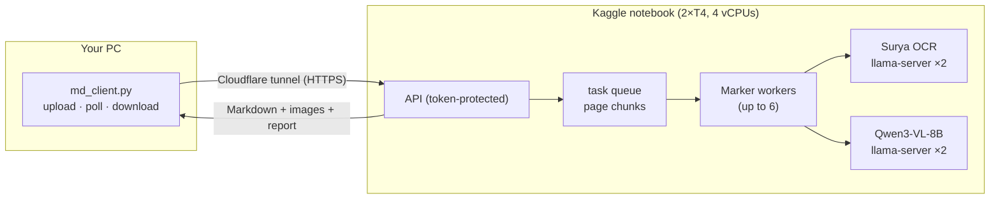

<div align="center">

# doc-to-markdown

**Turn any document into clean, faithful Markdown on a free Kaggle GPU box, driven from your PC.**

PDFs (digital or scanned), images, Word, PowerPoint, Excel, EPUB, HTML, DjVu, in any language, come back as
Markdown with text, headings, tables, LaTeX equations, code, figures and the content of every figure. A vision
model checks the result, and its changes are only kept if they lose nothing.

[](LICENSE)
[](md_client.py)[-20BEFF.svg)](docs/getting-started.md)

[Getting started](docs/getting-started.md) ·
[Usage](docs/usage.md) ·
[Quality modes](docs/quality-modes.md) ·
[Architecture](docs/architecture.md) ·
[Configuration](docs/configuration.md) ·
[Troubleshooting](docs/troubleshooting.md) ·
[Contributing](CONTRIBUTING.md)

</div>

---

## Why this project

- **No GPU of your own needed.** All the heavy work runs on Kaggle's free 2 × NVIDIA T4 sessions (30 GPU-hours
  a week). Your PC only needs Python 3.10+ and one file: [`md_client.py`](md_client.py), which uses only the
  standard library.
- **Nothing silently lost.** Every change a model proposes is checked before it is kept. No word or number of
  the page may disappear, nothing may be invented, and a page's printed text (its PDF text layer) has the final
  say wherever it exists. See [How accuracy is protected](docs/accuracy.md).
- **Figures are content, not decoration.** Figures are cropped to the figure itself, and each one is described.
  Flow charts and UML diagrams become [Mermaid](https://mermaid.js.org/) charts, and pictures of text (a
  newspaper page, a letter) are transcribed in full.
- **Every script.** Bengali, Hindi and other Indic scripts, Chinese, Japanese, Arabic, Cyrillic and more, with
  repairs for the typical OCR and PDF-text errors of Indic scripts.
- **Long books and many files.** Documents are split into page chunks and spread over all workers. Long
  documents come back in batches, each saved as soon as it's done, and an interrupted run resumes where it
  stopped.

## How it works



1. **[Marker](https://github.com/datalab-to/marker)** finds the layout and reads the text: the PDF's own text
   where it is good, otherwise the Surya OCR model on the GPUs. It also extracts tables, equations and figures.
2. **Deterministic repairs**, no model involved:
   - figures re-cropped so labels aren't cut off;
   - tables checked against the page image;
   - OCR slips corrected from the PDF's own text;
   - Indic vowel-order fixes;
   - equation numbers turned into `\tag{}`;
   - Markdown clean-up.
3. **A vision LLM** (Qwen3-VL-8B, one server per GPU) describes figures, reviews pages and proofreads them line
   by line. Each of its changes passes a loss check before it is kept.
4. The result comes back as `<name>/<name>.md`, its images and a `report.json`. The report records what was
   checked, what was changed, and how busy the box's GPUs, CPUs and RAM were.

## Quick start

**1. Set up the box (once).** Create a Kaggle notebook from
[`docs_to_markdown_cloudflare.ipynb`](docs_to_markdown_cloudflare.ipynb), then set it up:
- choose **GPU T4 ×2** and switch **Internet on**;
- add a secret **`BOX_TOKEN`**: any random string of 16+ characters;
- **Save & Run All**.

After about 10 minutes the log shows **BOX READY**. Details: [Getting started](docs/getting-started.md).

**2. Convert from your PC.** Put the same token into a file named `.box_token` next to `md_client.py`:

```bash
python md_client.py book.pdf                      # -> markdown_out/book/book.md + images + report.json
python md_client.py ./papers --out ./md           # a whole folder (sub-folders kept)
python md_client.py scan.pdf --quality accurate   # the most careful mode
python md_client.py --health                      # is the box up? GPUs, workers, memory
```

The client finds the box by itself: the box announces its address, signed with your token. If that fails,
pass `--url` with the address from the BOX READY banner.

## Quality modes

| | `fast` | `balanced` (default) | `accurate` |
|---|---|---|---|
| OCR, figure crops, table/formula fixes, text-layer repair | ✓ | ✓ | ✓ |
| Figure descriptions, figures cropped to themselves | ✓ | ✓ | ✓ |
| Flow diagrams → Mermaid | 1 read | 2 reads + missing-arrow check | 3 reads + check |
| Marker's own LLM steps (tables, equations, headings) | – | ✓ | ✓ (+ inline maths) |
| Pictures of text transcribed in full | – | ✓ | ✓ |
| Page review by the vision LLM | – | whole page | section by section |
| Line-by-line audit, every fix double-checked | 1 pass, large sections | 1 pass | 2 passes, smaller sections |
| **27-page benchmark: time** | **520 s** | **1068 s** | **1192 s** |
| **27-page benchmark: checks passed** | **56 / 59** | **57 / 59** | **56 / 59** |

The benchmark is a 27-page test document with one hard case per page:
- UML diagrams, dense LaTeX, C and R code, charts;
- a 1900 newspaper scan and a 1794 handwritten invoice;
- Bengali and Chinese text;
- multi-panel figures and tables.

The table shows the latest run of each mode on Kaggle 2×T4 in November 2026. Times vary by about ±10% between
runs, and a check or two flips between runs because the LLM's answers vary. A later balanced run passed 58/59.
The document contains personal data, so it isn't published. [Quality modes](docs/quality-modes.md) explains
how to choose a mode and how to measure the same trade-off on your own documents.

## Supported inputs

| Kind | Formats |
|---|---|
| PDF | digital and scanned (OCR), with or without a text layer |
| Images | PNG, JPEG, WebP, TIFF, GIF, BMP |
| Office | Word, PowerPoint, Excel and OpenDocument, old and new: `.docx` `.doc` `.rtf` `.odt` · `.pptx` `.ppt` `.odp` · `.xlsx` `.xls` `.ods` and their variants (via LibreOffice) |
| Other | EPUB, HTML, DjVu, TXT, Markdown, CSV/TSV, and `.zip` archives of any of these |

The full list is in [Usage → Supported inputs](docs/usage.md#supported-inputs).

## Documentation

| Guide | What's in it |
|---|---|
| [Getting started](docs/getting-started.md) | Kaggle setup step by step, the client, your first conversion |
| [Usage](docs/usage.md) | every client option, batches and resume, local workers, outputs and `report.json` |
| [Quality modes](docs/quality-modes.md) | what each mode does, benchmarks, choosing a mode, measuring your own |
| [How accuracy is protected](docs/accuracy.md) | the loss checks, the audit, text-layer repair, what is never changed |
| [Architecture](docs/architecture.md) | components, data flow, scheduling, memory safety, GPU servers |
| [Configuration](docs/configuration.md) | every notebook setting and environment variable |
| [Performance](docs/performance.md) | where time goes, resource use, tuning |
| [HTTP API](docs/api.md) | the box's endpoints, for your own clients |
| [Troubleshooting](docs/troubleshooting.md) | common problems and what log lines mean |
| [Development](docs/development.md) | repository layout, tests without a GPU, building the notebook |
| [Design notes](docs/design-notes.md) | the detailed engineering log: every decision and what it was measured on |

## Limitations

- Kaggle sessions end after at most 12 hours (the notebook stops at 8.5 h and when idle), and the free quota is
  30 GPU-hours a week.
- The vision LLM is an 8B model: excellent at reading, but it can misjudge rare symbols. That's why every one of
  its changes is checked, and why `accurate` asks it twice about each correction.
- Vertical Japanese text, very degraded scans and handwriting are read on a best-effort basis.
- Converting with `GOOGLE_API_KEY` (a Gemini fallback, off unless you add the key) sends page content to Google.
  Otherwise nothing leaves your Kaggle session except the results you download.

## Licenses

This project's code is licensed under the [Apache License 2.0](LICENSE). The notebook downloads third-party
software and models at run time, each under its own license (see [NOTICE](NOTICE)). Note in particular that
**Marker/Surya model weights** use a modified OpenRAIL-M license: free for research, personal use and small
startups, with a paid licence from [Datalab](https://www.datalab.to/pricing) needed for larger commercial use.

## Contributing

Bug reports, documents that convert badly, and pull requests are welcome. Please read
[CONTRIBUTING.md](CONTRIBUTING.md) and our [Code of Conduct](CODE_OF_CONDUCT.md). To report a security problem,
see [SECURITY.md](SECURITY.md).

## Acknowledgements

Built on [Marker and Surya](https://github.com/datalab-to/marker) by Datalab,
[llama.cpp](https://github.com/ggml-org/llama.cpp), [Qwen3-VL](https://huggingface.co/Qwen) and the
[Unsloth](https://huggingface.co/unsloth) GGUF builds, [Cloudflare Tunnel](https://github.com/cloudflare/cloudflared),
[ntfy.sh](https://ntfy.sh), [LibreOffice](https://www.libreoffice.org) and [Kaggle](https://www.kaggle.com).
