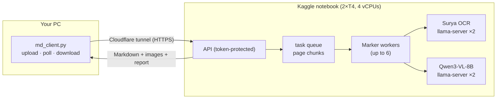

<div align="center">

# doc-to-markdown

**Turn any document into clean, faithful Markdown on a free Kaggle GPU box, driven from your PC.**

PDFs (digital or scanned), photos of book pages, images, Word, PowerPoint, Excel, EPUB, HTML, DjVu, in any
language, come back as Markdown with text, headings, tables, LaTeX equations, code, figures and the content of
every figure. A vision model checks the result, and its changes are only kept if they lose nothing.

[](https://github.com/eyasir329/doc-to-markdown/actions/workflows/ci.yml)
[](https://github.com/eyasir329/doc-to-markdown/releases/latest)
[](LICENSE)
[](md_client.py)
[-20BEFF.svg)](docs/getting-started.md)

[Getting started](docs/getting-started.md) ·
[Usage](docs/usage.md) ·
[Quality modes](docs/quality-modes.md) ·
[Architecture](docs/architecture.md) ·
[Configuration](docs/configuration.md) ·
[Troubleshooting](docs/troubleshooting.md) ·
[Contributing](CONTRIBUTING.md)

</div>

---

## Why this project

- **No GPU of your own needed.** All the heavy work runs on Kaggle's free 2 × NVIDIA T4 sessions (30 GPU-hours
  a week). Your PC only needs Python 3.10+ and one file: [`md_client.py`](md_client.py), which uses only the
  standard library.
- **Nothing silently lost.** Every change a model proposes is checked before it is kept. No word or number of
  the page may disappear, nothing may be invented, and a page's printed text (its PDF text layer) has the final
  say wherever it exists. See [How accuracy is protected](docs/accuracy.md).
- **Three clear speed/accuracy levels.** `express` makes no vision-LLM call, `standard` uses it only on the pages
  that need it, `precise` gives every page every check. See [Quality modes](docs/quality-modes.md).
- **Scans and phone photos handled.** Pages are set upright, a photo of two facing book pages is cut into its two
  pages, and text the layout missed is still read.
- **Figures are content, not decoration.** Figures are cropped to the figure itself, the text inside them is read,
  and each one is described by its meaning. Flowcharts, UML activity, state and sequence diagrams, workflows and
  trees become [Mermaid](https://mermaid.js.org/) charts.
- **Every script.** Bengali, Hindi and other Indic scripts, Chinese, Japanese, Hebrew, Arabic, Cyrillic and more,
  with repairs for the typical OCR and PDF-text errors of Indic scripts.
- **Long books and many files.** Documents are split into page chunks and spread over all workers. Long
  documents come back in batches, each saved as soon as it's done, and an interrupted run resumes where it
  stopped.

## How it works



1. **Scans first.** Pages without a text layer are set upright, and two-page book photos are cut in two.
2. **[Marker](https://github.com/datalab-to/marker)** finds the layout and reads the text: the PDF's own text
   where it is good, otherwise the Surya OCR model on the GPUs. Text lines the layout left out are read too.
3. **Deterministic repairs**, no model involved: figures re-cropped so labels aren't cut off, tables checked
   against the page image, OCR slips corrected from the PDF's own text, Indic vowel-order fixes, equation numbers as
   `\tag{}`, headings from the PDF outline, Markdown clean-up.
4. **A vision LLM** (Qwen3-VL-8B, one server per GPU), in `standard` and `precise`, checks pages against their
   images (an element check, exact corrections each confirmed, in `precise` a line-by-line rewrite) and describes
   figures. Each of its changes passes a loss check before it is kept.
5. The result comes back as `<name>/<name>.md`, its images and a `report.json`. The report records what was
   checked, what was changed, and how busy the box's GPUs, CPUs and RAM were.

## Quick start

**1. Set up the box (once).** Create a Kaggle notebook from
[`docs_to_markdown_cloudflare.ipynb`](docs_to_markdown_cloudflare.ipynb), then set it up:
- choose **GPU T4 ×2** and switch **Internet on**;
- add a secret **`BOX_TOKEN`**: any random string of 16+ characters;
- **Save & Run All**.

After about 10 minutes the log shows **BOX READY**. Details: [Getting started](docs/getting-started.md).

**2. Convert from your PC.** Put the same token into a file named `.box_token` next to `md_client.py`:

```bash
python md_client.py book.pdf                      # -> markdown_out/book/book.md + images + report.json
python md_client.py ./papers --out ./md           # a whole folder (sub-folders kept)
python md_client.py big.pdf --quality express     # fastest: no vision-LLM pass
python md_client.py scan.pdf --quality precise    # the most careful mode
python md_client.py --health                      # is the box up? GPUs, workers, memory
```

The client finds the box by itself: the box announces its address, signed with your token. If that fails,
pass `--url` with the address from the BOX READY banner.

## Quality modes

| | `express` | `standard` (default) | `precise` |
|---|---|---|---|
| Scans upright, two-page photos cut, OCR, figure crops, table/formula fixes, text-layer repair | ✓ | ✓ | ✓ |
| Text inside pictures read by the OCR | ✓ | ✓ | ✓ |
| Vision-LLM page checks: element check + exact corrections | – | pages that need them | every page |
| Line-by-line rewrite, prose made explicit (original wording kept) | – | – | ✓ |
| Figures described by meaning, flowcharts → Mermaid | – | pages with diagrams or charts | every figure |
| **30-page regression set: time** | **233 s** | **842 s** | **2107 s** |
| **Pages per hour** | **466** | **128** | **51** |
| **Regression checks passed** | **10 / 10** | **13 / 13** | **11 / 11** |

The regression set has one hard case per page: seven two-page book photos and pages that must not be cut,
upside-down and sideways photos, handwritten notes, degraded historical scans, receipts and invoices, tables, maths,
code, charts and flowcharts, and Chinese, Devanagari and Hebrew text. It was run on Kaggle 2×T4 with release 2.0.0.
It contains third-party and personal scans, so it isn't published. In every mode all 30 pages came back, every
two-page photo and nothing else was cut, and no page repeated itself; `standard` kept 38 of the vision LLM's
corrections and `precise` 118. [Quality modes](docs/quality-modes.md) explains how to choose and how to measure the
trade-off on your own documents.

## Supported inputs

| Kind | Formats |
|---|---|
| PDF | digital and scanned (OCR), with or without a text layer |
| Images | PNG, JPEG, WebP, TIFF, GIF, BMP, including phone photos of book pages |
| Office | Word, PowerPoint, Excel and OpenDocument, old and new: `.docx` `.doc` `.rtf` `.odt` · `.pptx` `.ppt` `.odp` · `.xlsx` `.xls` `.ods` and their variants (via LibreOffice) |
| Other | EPUB, HTML, DjVu, TXT, Markdown, CSV/TSV, and `.zip` archives of any of these |

The full list is in [Usage → Supported inputs](docs/usage.md#supported-inputs).

## Documentation

| Guide | What's in it |
|---|---|
| [Getting started](docs/getting-started.md) | Kaggle setup step by step, the client, your first conversion |
| [Usage](docs/usage.md) | every client option, batches and resume, local workers, outputs and `report.json` |
| [Quality modes](docs/quality-modes.md) | what each mode does, how `standard` decides per page, measured results, choosing a mode |
| [How accuracy is protected](docs/accuracy.md) | scans first, the loss checks, the element check, the audit, what is never changed |
| [Architecture](docs/architecture.md) | components, data flow, scheduling, memory safety, GPU servers, failure handling |
| [Configuration](docs/configuration.md) | every notebook setting, per-job option and environment variable |
| [Performance](docs/performance.md) | where time goes, resource use, the regression checks, tuning |
| [HTTP API](docs/api.md) | the box's endpoints, for your own clients |
| [Troubleshooting](docs/troubleshooting.md) | common problems and what log lines mean |
| [Development](docs/development.md) | repository layout, tests without a GPU, benchmarks, building the notebook |
| [Design notes](docs/design-notes.md) | why the pipeline is built the way it is |

## Limitations

- Kaggle sessions end after at most 12 hours (the notebook stops at 8.5 h and when idle), and the free quota is
  30 GPU-hours a week.
- The vision LLM is an 8B model: excellent at reading, but it can misjudge rare symbols. That's why every one of
  its changes is checked, and why each correction must be confirmed by the page's text or picked twice.
- `express` has no vision-LLM checks: it keeps all the text the OCR reads, OCR slips included.
- Handwriting, very degraded scans and vertical Japanese text are read on a best-effort basis; use `precise` and
  read the result.
- Converting with `GOOGLE_API_KEY` (a Gemini fallback, off unless you add the key) sends page content to Google.
  Otherwise nothing leaves your Kaggle session except the results you download.

## Licenses

This project's code is licensed under the [Apache License 2.0](LICENSE). The notebook downloads third-party
software and models at run time, each under its own license (see [NOTICE](NOTICE)). Note in particular that
**Marker/Surya model weights** use a modified OpenRAIL-M license: free for research, personal use and small
startups, with a paid licence from [Datalab](https://www.datalab.to/pricing) needed for larger commercial use.

## Contributing

Bug reports, documents that convert badly, and pull requests are welcome. Please read
[CONTRIBUTING.md](CONTRIBUTING.md) and our [Code of Conduct](CODE_OF_CONDUCT.md). To report a security problem,
see [SECURITY.md](SECURITY.md).

## Acknowledgements

Built on [Marker and Surya](https://github.com/datalab-to/marker) by Datalab,
[llama.cpp](https://github.com/ggml-org/llama.cpp), [Qwen3-VL](https://huggingface.co/Qwen) and the
[Unsloth](https://huggingface.co/unsloth) GGUF builds, [Cloudflare Tunnel](https://github.com/cloudflare/cloudflared),
[ntfy.sh](https://ntfy.sh), [LibreOffice](https://www.libreoffice.org) and [Kaggle](https://www.kaggle.com).
