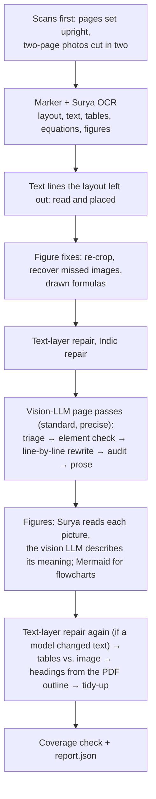

# How accuracy is protected

A vision LLM is a powerful proofreader, but it can also "fix" text that was right: it can drop a footnote,
change a number, or swap a ceiling bracket for a floor. This project lets the models *propose* changes and
deterministic checks *decide* whether to keep them. Three rules apply throughout:

1. **Deterministic repairs first.** Whatever can be fixed without a model is fixed by code, before any model
   pass, so no model call is spent on it.
2. **A change is kept only if it loses nothing.** No word or number of the page may disappear, and nothing may be
   invented.
3. **The page's own text has the final say.** Where the PDF has a text layer (the text a digital PDF carries),
   it outranks both the OCR and the LLM.

## The steps for each page

In `express` the vision-LLM boxes are skipped and Surya's reading of each picture goes under it. Which passes a page
gets in each mode is in [Quality modes](quality-modes.md).

## Scans first

A page without a text layer is read as Marker sees it, so an upside-down photo or a photo of two facing book pages
used to come out with missing and repeated lines. Before layout and OCR, in every mode:

- **Orientation.** Indra's orientation model checks each scanned page and decides quarter turns; an upside-down
  call must also read clearly better turned. The image itself is kept and the page is marked rotated.
- **Two-page photos.** A photo of an open book is found from the fold between its pages (a valley in the ink,
  with text lines on both sides, or a weaker fold confirmed by printed page numbers on both sides). It's cut into
  two upright pages, and the halves are put in printed order. A single page with an empty middle band, a music
  sheet, a curved page or an invoice isn't cut.
- **Text the layout left out.** Text lines that Marker's layout put in no block are found with Indra's line
  detector, grouped, and read by Surya. A region is added only when it reads clearly as text of this page (not
  specks, page edges, or the other side of the paper showing through, which reads better mirrored).

## The element check

The vision LLM gets the page image and the page's Markdown split into numbered elements (paragraphs, headings,
lists, tables, code blocks, formulas). It reports only elements that are wrong: the wrong kind (maths written as
text, code not in a code block, a list written as a paragraph, a wrong heading level), a wrong structure (a table's
rows or columns), split or merged paragraphs, and missing words. Figures and link anchors are replaced by
`<<KEEP n>>` tokens first, so the model cannot drop, move or rewrite them.

A fix is refused if it would drop maths, a code block, bold or italic formatting, or forced line breaks, and it
must pass the loss check below. The model may also report content that's on the page but in no element:

- **Missing text** is added only with evidence: at least 90% of its words in the page's text layer, or, on a scan,
  two "yes" answers to two differently put questions about whether the page shows it.
- **Missing figures** are cropped from the page where the model points, kept only if the crop has ink and doesn't
  overlap a figure the Markdown already has.

## The loss check

Every rewrite the vision LLM proposes (the line-by-line rewrite, element fixes) is checked by `review.accept`. It's
refused if it:

| Check | Refused when |
|---|---|
| Completeness | the answer is empty or cut off, a `<<KEEP n>>` token is missing or repeated, or a token was invented |
| Words | fewer than 90% of the draft's distinct words are kept, words appear that neither the draft nor the page's text has, or the page's real words are lost |
| Numbers | any number changes. Numbers must survive exactly |
| Structure | a heading is lost, a checkbox changes state, an escaped `\$` becomes a maths `$` |
| Symbols | a ceiling becomes a floor or back |

The check allows for what a good proofread legitimately changes: known OCR confusions, Greek letters written as
names (`alpha` ↔ `\alpha` ↔ α), and a footer the draft dropped that the page's text has.

**Paragraph by paragraph.** If a whole rewrite fails the check, each changed paragraph is judged on its own and the
good ones are kept. A paragraph the strict check refuses is still used when every word and number of it is in the
page's own text.

## The line-by-line rewrite (`precise`)

The vision LLM writes the page again a few lines at a time (parts of about 600 tokens), each part against the page
image and its own lines of the page's text layer. Each part must pass the loss check; a refused part keeps the
draft. A page its own text settles (every word of it is the PDF's, nothing of the text layer is missing, and it
has no maths, code or table) gets no rewrite: nothing on it can be improved.

## The audit

The audit asks the vision LLM for *exact corrections only*: "old → new" pairs under 60 characters. In `standard` it
sees the whole page at once (split only if the page doesn't fit the context); on hard pages, and in `precise`, it
works three paragraphs at a time, which finds what bigger sections miss. Each proposed fix must pass all of these:

1. **It changes something**, and its "old" text is actually in the section, exactly once.
2. **It's small.** A local correction, not a rewrite.
3. **It keeps maths and formatting.** It may not remove `$`, `*`, `_` or `` ` ``.
4. **It isn't contradicted by the page.** If the page's own text has the old wording as printed (8+ characters),
   the fix is refused. This stops the model from "completing" words the page itself cuts off.
5. **It's confirmed** in one of two ways:
   - the page's text layer has the new wording;
   - a two-way second look: the model is shown both versions, in both orders, and must pick the new one both
     times.

Sections whose every word comes from the text layer, with no maths, code or table, are skipped as settled. The
report counts confirmed fixes, refusals (with the reason) and settled sections. On the regression set the audit
caught, among others, `I_E = I_D + I_C` → `I_E = I_B + I_C` in handwritten notes, `অনেক দুত` → `অনেক দ্রুত` in
Bengali, and `牡丹准货记卡` → `牡丹准贷记卡` on a Chinese card.

## Prose made explicit (`precise`)

Last, each prose paragraph that may have been read inaccurately is written again more clearly: garbled text as the
page shows it, abbreviations expanded, "it"/"this" made explicit. Paragraphs whose words are 99% in the page's own
text are left alone. A rewrite is kept only if it keeps 95% of the words, every number, and every `$`, `**` and
`` ` ``, adds no number and is at most 2.5× as long. The author's exact wording stays below each rewritten
paragraph, in a collapsed "Original wording" block. On the regression set 48 paragraphs were rewritten and 52
rewrites were refused, 9 of them because they added a number.

## Deterministic repairs (no model)

| Repair | What it fixes |
|---|---|
| **Text-layer repair** | A Markdown line that matches a line of the PDF's text (90%+) but differs in a few characters takes the PDF's version. Lines with maths are only repaired against text-layer lines that print the same `$`. A page whose text layer disagrees with most lines is left alone (an untrustworthy layer). It runs before the vision LLM's passes and once more after them |
| **Untrustworthy text layers** | Glyphs without Unicode, private-use characters and old Bijoy-font Bengali ("Avwg evsjvq") are detected, and those pages are OCR'd |
| **Indic repair** | Marker's text extractor stores Indic vowel signs in visual order (আমাদের came out as আমাদরে). Words are realigned against the page's text |
| **Tables vs. image** | Values that slid into the wrong column are moved back, using the ink positions in the page image. Icons inside table cells are cropped from the ruled grid and placed in their cells |
| **Drawn formulas** | A formula made of drawn shapes that LaTeX can't express becomes a picture of the formula, instead of a wrong formula |
| **Equation numbers** | "(7.3)" next to a display equation becomes `\tag{7.3}` |
| **Code split by the layout** | A program listing the layout cut into several code blocks is joined back into one |
| **Markdown tidy-up** | A `\|` inside a table cell no longer splits the row. HTML leftovers, stale list numbers, unbalanced `$$`, repeated OCR lines and task lists are fixed |
| **Headings** | Heading levels come from the PDF's outline (bookmarks) where it has one |

## Figures

- **Cropped to the figure.** Marker's boxes are often too tight. Figures are re-cropped from the page at 300 DPI so
  labels and legends aren't cut off, and split pieces are joined. Page rules and running headers at a crop's edge
  are peeled off without a model; in `standard` and `precise` the vision LLM then marks what in the crop is *not*
  the figure (its caption, a "FIGURE 5.3" tab, running text), and the crop snaps to the figure's own ink.
- **Recovered.** Images Marker's layout model missed are found in the PDF and added at their place.
- **Read.** Surya reads the text inside every picture of 200 px or more (a scan, a diagram's labels, a chart's
  values). In `express` that reading goes under the picture, if it holds real text and not noise or repeats.
- **Described by meaning** (`standard`: figures on pages with diagrams or charts; `precise`: every figure). The
  description starts with what the figure shows and why, then gives what's inside it, with Surya's reading as
  evidence. When Surya read 40 words or more in it (a newspaper page, a letter), its full reading is kept under
  the description, so no word is lost to a summary.
- **Flowcharts as Mermaid.** A figure the description calls a flowchart is read as a graph (nodes, decisions,
  every arrow) and drawn as a Mermaid chart. Several reads must agree, and a separate check looks for missing
  arrows. Circuits, charts and other diagrams are described, not drawn.
- **Repeated images** (a logo on every page) are described once. Logos and icons are named in the alt text.

## Languages

- **Any Unicode script.** Surya reads 90+ languages and Qwen3-VL is multilingual.
- **Word comparison by script.** The checks compare words in a way that suits each script: Latin, Indic, CJK
  (by character), Arabic and so on.
- **No translation.** The vision LLM keeps the page's language and script and never translates. Figure
  descriptions are written in the document's language, with labels exactly as printed.
- **Broken paragraphs joined.** A paragraph split by a page break is joined back, whatever the script's closing
  punctuation (。 । ۔ …).

## The coverage check

After conversion, every word of each page's PDF text layer is looked up in the Markdown. `report.json` gets
`text_coverage`, plus `low_coverage_pages` for pages under 90%, and the client warns about them. This catches lost
*text*; figure content is covered by the figure steps.

## What can still go wrong

- **Scans without a text layer** have no independent evidence. The OCR and the vision LLM are all there is, so
  read the result of important scans, or use `precise`.
- **`express` has no vision-LLM checks.** It keeps all the text Surya reads, but OCR slips stay.
- **The 8B model can misjudge rare symbols.** The checks stop it from making things worse, but they can't make it
  see what it can't.
- **Mermaid shows a flowchart's structure, not its layout.** The image is always kept next to it.
- **Tables continuing across chunk boundaries.** Long PDFs are split into page chunks of up to 24 pages, so a
  table that continues across a boundary stays as two tables. `SPLIT_MIN_PAGES = 0` turns splitting off.
