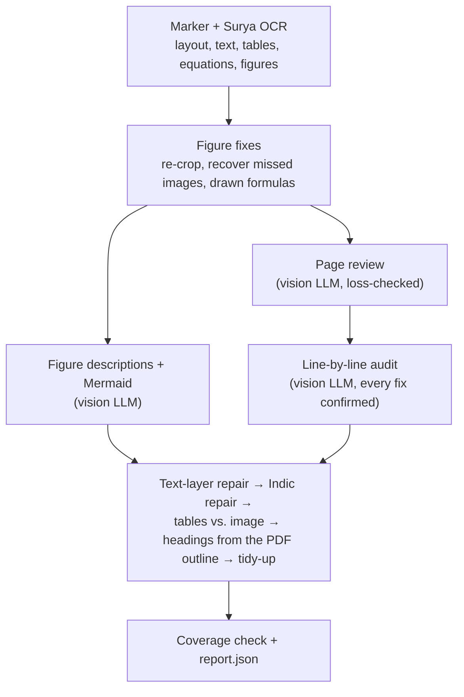

# How accuracy is protected

A vision LLM is a powerful proofreader, but it can also "fix" text that was right: it can drop a footnote,
change a number, or swap a ceiling bracket for a floor. This project lets the models *propose* changes and
deterministic checks *decide* whether to keep them. Three rules apply throughout:

1. **Deterministic repairs first.** Whatever can be fixed without a model is fixed by code.
2. **A change is kept only if it loses nothing.** No word or number of the page may disappear, and nothing may be
   invented.
3. **The page's own text has the final say.** Where the PDF has a text layer (the text a digital PDF carries),
   it outranks both the OCR and the LLM.

## The steps for each page

## Marker's own LLM steps are checked

In `balanced` and `accurate`, Marker uses the vision LLM to improve tables, equations, forms and headings. Its
answers are checked before they're used. Marker keeps its own version when the LLM's answer:

- talks *about* the block ("The equation shows …") instead of giving it;
- replaces maths with prose;
- changes a ceiling ⌈ ⌉ into a floor ⌊ ⌋ or back;
- swaps the symbols (for example, the Greek letters λ and ε came back as `\boldsymbol{\nu}`).

## The page review

The vision LLM gets three inputs: the page image, Marker's draft Markdown of that page, and the page's text layer
when there is one. It returns a corrected page:
- misread words fixed;
- proper headings, lists, tables, LaTeX and code fences;
- paragraphs joined for reading.

Figures (with their descriptions) and link anchors are replaced by `<<KEEP n>>` tokens first, so the model cannot
drop, move or rewrite them.

The rewrite is then checked (`review.accept`). It's refused if it:

| Check | Refused when |
|---|---|
| Completeness | the answer is empty, a `<<KEEP n>>` token is missing or repeated, or a token was invented |
| Words | fewer than 90% of the draft's distinct words are kept, words appear that neither the draft nor the page's text has, or the page's real words are lost |
| Numbers | any number changes. Numbers must survive exactly |
| Structure | a heading is lost, a checkbox changes state, an escaped `\$` becomes a maths `$` |
| Symbols | a ceiling becomes a floor or back |

The check allows for what a good proofread legitimately changes: known OCR confusions, Greek letters written as
names (`alpha` ↔ `\alpha` ↔ α), and a footer the draft dropped that the page's text has.

**Paragraph by paragraph.** If the whole rewrite fails the check, each changed paragraph is judged on its own,
and the good ones are kept. A paragraph the strict check refuses is still used when every word and number of it
is in the page's own text.

**Settled pages.** In `fast` and `balanced`, the review is skipped where the page's text layer fully settles the
page. That means every word of the draft comes from the text layer, nothing of the layer is missing, and there's
no maths, code or table. Such a page came straight from the PDF's text, so a proofread can't improve it.

**Section by section** (`accurate`). The page is split into sections of at most 900 tokens. Each is reviewed with
its own lines of the page's text, so the model keeps all of it in view.

## The line-by-line audit

The audit asks the vision LLM for *exact corrections only*. It looks at a few paragraphs at a time next to the
page image and answers with "old → new" pairs (each under 60 characters). Each proposed fix must pass all of
these checks:

1. **It changes something**, and its "old" text is actually in the section.
2. **It's small.** A local correction, not a rewrite.
3. **It keeps maths and formatting.** It may not remove `$`, `*`, `_` or `` ` ``.
4. **It isn't contradicted by the page.** If the page's own text has the old wording as printed (8+ characters),
   the fix is refused. This stops the model from "completing" words the page itself cuts off.
5. **It's confirmed** in one of two ways:
   - the page's text layer has the new wording;
   - a two-way second look. The model is shown both versions, in both orders, and must pick the new one both
     times.

Sections whose every word comes from the text layer, with no maths, code or table, are skipped as "settled". The
report counts confirmed fixes, refusals (with the reason) and settled sections.

What the audit catches that a whole-page review misses:
- Chinese OCR look-alikes (数字李生 → 数字孪生, 音服热线 → 客服热线);
- `\sqrt[2]{2}` where the page prints `\sqrt{2}`;
- `y^n` where the page prints `y^m`.

## Deterministic repairs (no model)

| Repair | What it fixes |
|---|---|
| **Text-layer repair** | A Markdown line that matches a line of the PDF's text (90%+) but differs in a few characters takes the PDF's version. Lines with maths are only repaired against text-layer lines that print the same `$`. A page whose text layer disagrees with most lines is left alone (an untrustworthy layer) |
| **Untrustworthy text layers** | Glyphs without Unicode, private-use characters and old Bijoy-font Bengali ("Avwg evsjvq") are detected, and those pages are OCR'd |
| **Indic repair** | Marker's text extractor stores Indic vowel signs in visual order (আমাদের came out as আমাদরে). Words are realigned against the page's text |
| **Tables vs. image** | Values that slid into the wrong column are moved back, using the ink positions in the page image. Icons inside table cells are cropped from the ruled grid and placed in their cells |
| **Drawn formulas** | A formula made of drawn shapes (pentagons, triangles) that LaTeX can't express becomes a picture with a description, instead of a wrong formula |
| **Equation numbers** | "(7.3)" next to a display equation becomes `\tag{7.3}` |
| **Markdown tidy-up** | A `\|` inside a table cell (maths `$\|x\|$`, code `a \|\| b`) no longer splits the row. HTML leftovers, stale list numbers, unbalanced `$$` and task lists are fixed |
| **Headings** | Heading levels come from the PDF's outline (bookmarks) where it has one |

## Figures

- **Cropped to the figure.** Marker's boxes are often too tight. Figures are re-cropped from the page at 300 DPI so
  labels and legends aren't cut off, and split pieces are joined. The vision LLM then marks what in the crop is
  *not* the figure (its caption, a "FIGURE 5.3" tab, running text), and the crop snaps to the figure's own ink.
- **Recovered.** Images Marker's layout model missed are found in the PDF and added at their place.
- **Described.** Each description starts with what the figure shows, then gives everything inside it: every
  label, number and value, a chart's axes and series, a schematic's parts. It's written in the document's
  language.
- **Graphs as Mermaid.** Flowcharts and UML activity diagrams are read as a graph (nodes, decisions, fork/join
  bars, every arrow) and drawn as a Mermaid chart. Several reads must agree, and a separate check looks for
  missing arrows.
- **Pictures of text** (a newspaper page, a letter, a screenshot) are transcribed in full in `balanced` and
  `accurate`. Sampling settings stop the model from repeating itself; an answer that was cut off or looped is
  read again tile by tile.
- **Repeated images** (a logo on every page) are described once. Logos and icons are named in the alt text.

## Languages

- **Any Unicode script.** Surya reads 90+ languages and Qwen3-VL is multilingual.
- **Word comparison by script.** The checks compare words in a way that suits each script: Latin, Indic, CJK
  (by character), Arabic and so on.
- **No translation.** The page review keeps the page's language and script and never translates.
- **Broken paragraphs joined.** A paragraph split by a page break is joined back, whatever the script's closing
  punctuation (。 । ۔ …).

## The coverage check

After conversion, every word of each page's PDF text layer is looked up in the Markdown. `report.json` gets
`text_coverage`, plus `low_coverage_pages` for pages under 90%, and the client warns about them. This catches lost
*text*; figure content is covered by the figure steps.

## What can still go wrong

- **Scans without a text layer** have no independent evidence. The OCR and the vision LLM are all there is, so
  read the result of important scans.
- **The 8B model can misjudge rare symbols.** The checks stop it from making things worse, but they can't make it
  see what it can't.
- **Mermaid shows a diagram's structure, not its layout.** The image is always kept next to it.
- **Tables continuing across chunk boundaries.** Long PDFs are split into page chunks of up to 24 pages, so a
  table that continues across a boundary stays as two tables. `SPLIT_MIN_PAGES = 0` turns splitting off.
