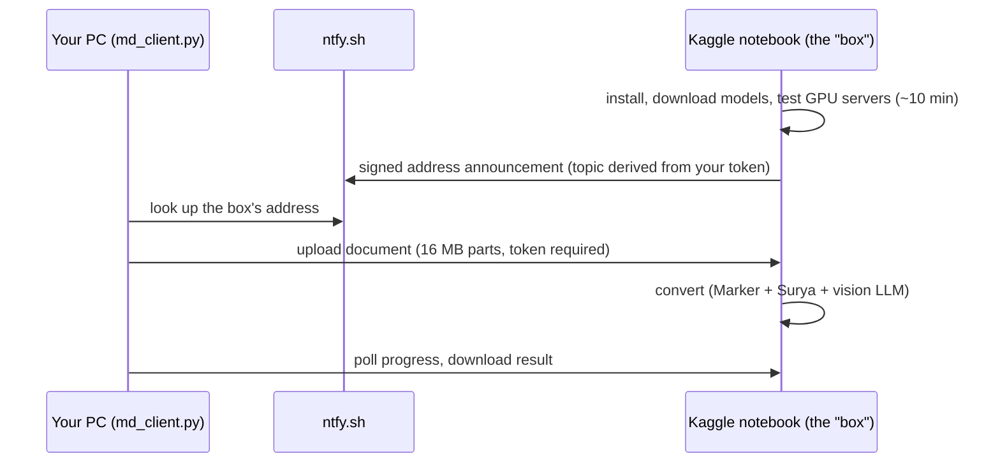

# Getting started

This guide takes you from nothing to your first converted document in about 15 minutes. You need:

- a **Kaggle account** with a verified phone number (Kaggle requires one for GPUs and internet access);
- **Python 3.10 or newer** on your PC (Windows, macOS or Linux). Nothing else is needed for the client.



## 1. Choose a token

The token protects your box: every request needs it, and your PC uses it to find the box's address. Generate a
random one of at least 16 characters, for example:

```bash
python -c "import secrets; print(secrets.token_urlsafe(32))"
```

Keep it private: anyone with the token can use your box while it runs.

## 2. Set up the Kaggle notebook (once)

1. On Kaggle, choose **Create → New Notebook**, then in the editor **File → Import Notebook**, and upload
   [`docs_to_markdown_cloudflare.ipynb`](../docs_to_markdown_cloudflare.ipynb) from this repository.
2. In the notebook's settings panel:
   - **Accelerator → GPU T4 ×2**;
   - **Internet → On**.
3. **Add-ons → Secrets → Add a secret**:

   | Label | Value | Needed? |
   |---|---|---|
   | `BOX_TOKEN` | the token from step 1 | **required** |
   | `HF_TOKEN` | a Hugging Face read token | optional: authenticated model downloads |
   | `GOOGLE_API_KEY` | a Gemini API key | optional: used only if the local vision LLM can't start. It sends page content to Google |

   Tick the checkbox next to each secret so the notebook can read it.
4. (Optional) Change settings in section **1. Configuration** of the notebook: the default quality, the idle
   timeout, the session length. The defaults are tuned for Kaggle's 2×T4 machine; see
   [Configuration](configuration.md).

## 3. Start the box

Click **Save Version → Save & Run All (Commit)**. This runs the notebook in the background, so you can close the
browser. To follow its progress, open the running version and look at its log. Alternatively, press **Run All** in
the editor to run it interactively; Kaggle stops an interactive session after a while without browser activity.

The first run takes about 10 minutes:

| Section | What happens |
|---|---|
| 2. Install Marker | Marker (pinned version), LibreOffice, fonts for every script |
| 3. GPU programs | llama.cpp's released CUDA build (about 30 s; compiled from source only as a fallback), the Surya model |
| 4. CPU models | Marker's layout models, downloaded once so the workers don't race |
| 5. Box files | writes the box's Python modules |
| 6. Preflight | checks the GPUs, internet and your secrets |
| 7. Start | starts the Surya and vision-LLM servers on both GPUs. Each one must pass a real test request |
| 8. Tunnel | opens a Cloudflare quick tunnel and announces its address |
| 9. Serve | serves jobs until idle (`IDLE_STOP_MIN`, 60 min) or the session limit (`SESSION_HOURS`, 8.5 h) |

When it's ready the log shows a banner like this:

```
================ BOX READY ================
  box   : markdown | default mode: balanced | LLM passes: qwen3-vl-8b
  url   : https://<random-words>.trycloudflare.com
  PC    : python md_client.py book.pdf          (add --local auto to also convert on your PC's CPUs)
===========================================
```

## 4. Set up your PC

1. Download this repository (or at least [`md_client.py`](../md_client.py)).
2. Save your token in a file named `.box_token` next to `md_client.py`. Alternatives: the `BOX_TOKEN`
   environment variable, or `--token`. `.gitignore` already excludes `.box_token`; never commit it.
3. Check the connection:

   ```bash
   python md_client.py --health
   ```

   This prints the box's GPUs, workers, models, memory and idle time. The client finds the box's address by
   itself. If that fails (for example ntfy.sh is blocked on your network), copy the `url` from the BOX READY
   banner and pass it with `--url`, or set `BOX_URL`.

## 5. Convert your first document

```bash
python md_client.py paper.pdf
```

The client uploads the file, shows progress, and downloads the result:

```
markdown_out/
├── report.json                      # one row per document: pages, time, checks, fixes, box resources
└── paper/
    ├── paper.md                     # the Markdown
    ├── paper_meta.json              # table of contents and page statistics
    └── _page_3_Picture_12.jpeg ...  # figures, linked from paper.md
```

Open `paper.md` in any Markdown viewer that renders LaTeX and Mermaid, for example VS Code with a Markdown
preview extension, Obsidian, Typora or GitHub.

Next steps:
- [Usage](usage.md): folders, batches, page ranges, all options.
- [Quality modes](quality-modes.md): `--quality fast | balanced | accurate`.

## 6. Optional: let your PC help

If you convert many files or long digital PDFs, your PC's CPUs can convert some pages next to the box. They use
the box's GPUs through the tunnel. Install the same Marker version as the notebook:

```bash
pip install -r requirements-local.txt
python md_client.py ./folder --local auto
```

`--local auto` (the default once Marker is installed) starts one worker per ~1.5 GB of free RAM, leaving two
cores free, at most 6. LibreOffice and `ddjvu` on your PC are optional. Files your PC can't convert exactly as
the box would always go to the box. For `--describe-again`, keep the `dev/` folder next to `md_client.py` and
install `numpy`, `pillow` and `scipy`.

## 7. Stopping the box

The box stops by itself after `IDLE_STOP_MIN` minutes without jobs (default 60), and always by `SESSION_HOURS`
(8.5 h). This saves your weekly GPU quota (Kaggle gives 30 GPU-hours a week). To stop it sooner, cancel the
running version on Kaggle. Results live in `/kaggle/tmp` and aren't kept after the session ends, so download what
you need first. The client always downloads results as soon as each job finishes.
